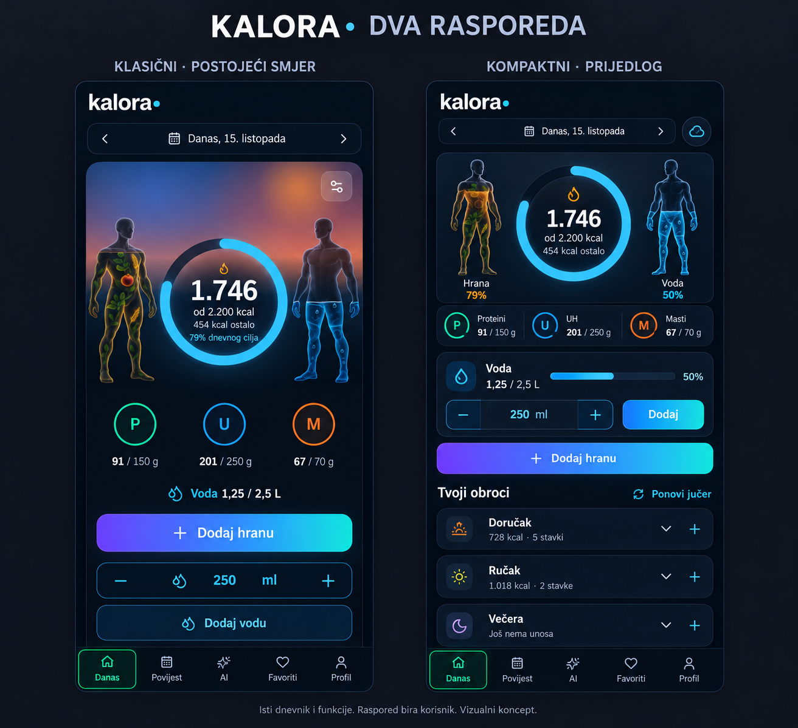
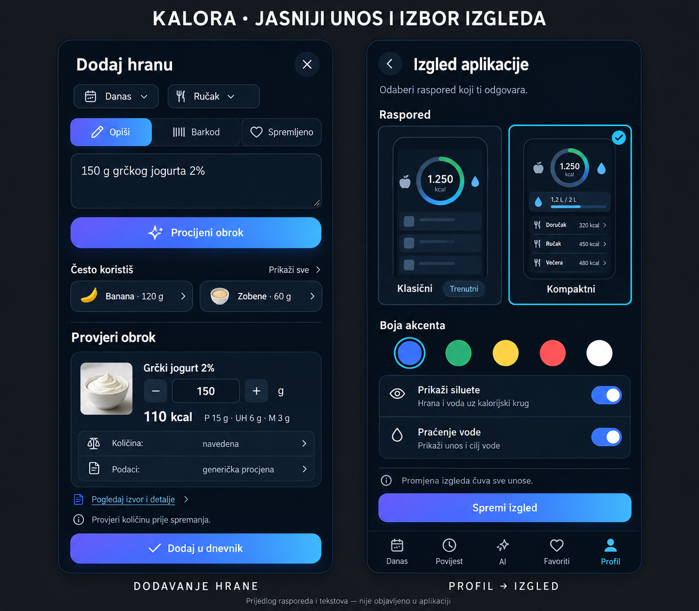

# Kalora — prijedlog unapređenja, 15. listopada 2026.

Preporuka je postupna dorada postojeće Kalore: sadašnji izgled ostaje zadani **Klasični**, uz jedan izbor **Kompaktni**. Siluete hrane i vode, unos vode, postojeći dnevnik i pet navigacijskih kartica ostaju u oba rasporeda. Ovo je prijedlog, bez promjene aplikacijskog koda ili produkcijskih podataka.

Prijedlog je temeljen na lokalno pregledanom kodu i lokalnim ekranima provjerene verzije `a83a04e`, sa sintetičkim podacima. Ne predstavlja snimku posljednje produkcijske objave.

## 1. Dva rasporeda istoga dnevnika

Lijevo je ilustracija postojećeg vizualnog smjera, desno opcionalni kompaktniji raspored. Silueta **Hrana** prikazuje napredak kalorijskog unosa, a **Voda** napredak prema cilju vode. To nisu prikazi izbora spola. Njihove brojčane oznake dodatno objašnjavaju značenje.

U sadašnjem mobilnom rasporedu velik sažetak, više prečaca i velika AI kartica dolaze prije stvarnih obroka. Kompaktni raspored smanjuje visinu sažetka, postavlja proteine/UH/masti u čitljiv red, grupira vodu s njezinim kontrolama i ranije prikazuje obroke. Gumb za dodavanje hrane ostaje glavni. Velika AI promotivna kartica dobiva sporedno mjesto; AI unos ostaje dostupan u dodavanju hrane i postojećoj AI kartici.

Samo gustoća i raspored prikaza trebaju biti različiti. Podaci, izračuni, Undo, sinkronizacija i postojeće radnje koriste zajedničku logiku. Sadašnji izgled ostaje zadani i postojeći korisnik može zadržati svoj izbor. Boja akcenta je zasebna postavka i već postoji.

## 2. Jasniji unos i objedinjene postavke izgleda

**Opiši / Barkod / Spremljeno** jasno razdvajaju načine unosa. Trenutačni naziv „Pretraga” obuhvaća opis obroka, dok su spremljene namirnice niže pod dodatnim opcijama. Postojeće često korištene namirnice i favoriti trebaju biti lakše dostupni. Jedan završni pregled pokazuje količinu, jedinicu, obrok i radnju „Dodaj u dnevnik”. Procjena i spremanje ostaju odvojene radnje.

Treba dosljedno prikazati dvije odvojene informacije:

- **Količina**: navedena ili procijenjena.
- **Nutritivni podaci**: AI, generička procjena, Open Food Facts ili vlastita deklaracija, uz izvor kada postoji.

Upisana točna gramaža ne znači da je nutritivni izvor neovisno provjeren. Za generičku procjenu bez poveznice prikazuju se detalji procjene; „Otvori izvor” prikazuje se samo kada izvor postoji. Tekstovi na vizualu su ilustracija za razradu, ne tvrdnja o novom provjerenom izvoru.

U **Profil → Izgled** grupirati izbor Klasični/Kompaktni, postojeće boje, siluete i praćenje vode. Prikazati male preglede obaju rasporeda i imati dosljedan način spremanja. Vizual predlaže jednu jasnu radnju „Spremi izgled”; sada se boja sprema odmah, a prekidači kroz spremanje profila. Izmjena izgleda treba čuvati sve unose i nespremljene osobne podatke. Postavka rasporeda imala bi kompatibilnu zadanu vrijednost za stare profile i izvoz/uvoz.

## 3. Jedna korisna nova funkcija nakon prve dorade

**Ponovi jučerašnji obrok**: izabrati obrok iz prethodnog dana, pregledati količine i potvrditi dodavanje u današnji dan. Pojedine stavke moraju dobiti nove identifikatore i vrijeme te pravi ciljni datum/obrok. Ne smije se izravno prepisivati današnji dnevnik. Taj je prečac prikazan na konceptu kao mogući sljedeći korak; prvi vizualni korak ne mora ga uključiti.

Favoriti cijelih obroka i rangiranje često/nedavno korištenih namirnica već postoje. Isto vrijedi za kalendar, tjedne/mjesečne prosjeke i trend težine. Njih treba učiniti jasnijima i dostupnijima, a ne iznova dodavati kao nove funkcije.

## 4. Redoslijed

1. Usuglasiti izgled kompaktnog ekrana i prozora za unos. Postojeći Klasični ostaje dostupan.
2. Dodati izbor dvaju rasporeda, urediti hijerarhiju, razmake, veličine dodira i postavke izgleda; obraditi zadanu vrijednost, spremanje i izvoz/uvoz postavke uz očuvanje starih profila.
3. Preurediti postojeće načine unosa i oznake količine/izvora. Zadržati završnu potvrdu, validaciju, iste podatke i istu sigurnu logiku.
4. Pokazati prototip nekolicini beta korisnika i usporediti koliko brzo dodaju hranu, nalaze vodu i razumiju dnevni sažetak.
5. Dodati ponavljanje obroka ako ga korisnici trebaju. Veći novi moduli mogu pričekati podatke iz bete.

Za prvi krug dorade dovoljno je srediti Danas, Dodaj hranu i Izgled. Procjena uspjeha: korisnik odmah vidi što je uneseno i što je ostalo, lako nađe obroke/vodu, prepoznaje AI procjenu te za ponavljajući obrok treba manje koraka. Svaki raspored provjeriti na malom telefonu, s većim tekstom i ekran čitačem; provjeriti promjenu računa, Undo i offline oporavak. Ovi koncepti sami po sebi nisu testirana implementacija.

## Što ovaj prijedlog ne isporučuje

Nema novog aplikacijskog paketa, SQL migracije, funkcionalne implementacije ili produkcijske objave. PNG slike su vizualni koncepti. Postojeći ZIP s popravcima na ovoj grani nije promijenjen ovim prijedlogom.
